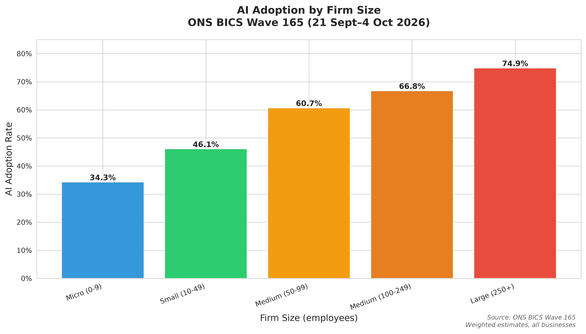
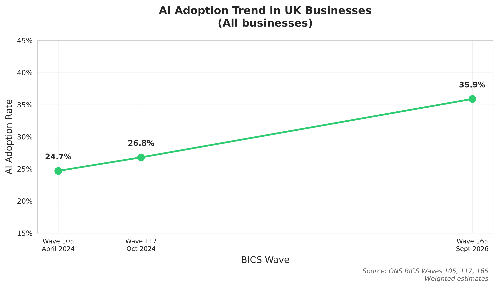
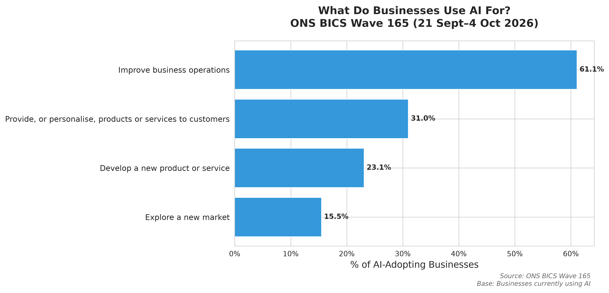
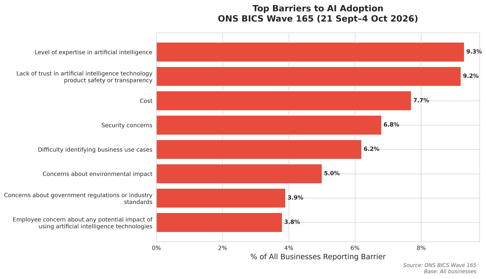

# AI Adoption in UK SMEs: A Research Study

Independent personal research project, unpaid and non-commercial, done in my own time using public data only. Not affiliated with, funded by or representing my employer or any organisation. Not advice.

## Overview

This repository contains a research-style analysis of artificial intelligence (AI) adoption among UK small and medium-sized enterprises (SMEs), using public data from the Office for National Statistics (ONS) Business Insights and Conditions Survey (BICS).

**Research Question:** What drives AI adoption in UK small and medium businesses?

## Key Findings

All findings calculated from ONS BICS Wave 165 (21 September–4 October 2026) published weighted estimates:

### AI Adoption by Firm Size
- **Micro firms (0-9 employees):** 34.3% currently use AI
- **Small firms (10-49 employees):** 46.1% currently use AI
- **Medium firms (50-99 employees):** 60.7% currently use AI
- **Medium firms (100-249 employees):** 66.8% currently use AI
- **Large firms (250+ employees):** 74.9% currently use AI
- **All businesses:** 35.9% currently use AI

**Key insight:** Clear positive gradient—larger firms are substantially more likely to adopt AI. Large firms (74.9%) are more than twice as likely to use AI as micro firms (34.3%).



### AI Adoption Trend (April 2024 – September 2026)
- **April 2024 (Wave 105):** 24.7%
- **October 2024 (Wave 117):** 26.8%
- **September 2026 (Wave 165):** 35.9%

**Key insight:** 11.2 percentage point increase over 18 months (45% relative growth). AI adoption is accelerating rapidly.



### Top Purposes for AI Use (Among Adopters)
1. **Improve business operations** – 61.1% of AI-using businesses
2. **Provide or personalise products/services** – 31.0%
3. **Develop a new product or service** – 23.1%
4. **Explore a new market** – 15.5%

**Key insight:** Businesses overwhelmingly use AI for operational efficiency (61%), not radical innovation.



### Top Barriers to AI Adoption (Among All Businesses)
1. **Level of expertise in AI** – 9.3%
2. **Lack of trust in AI technology safety/transparency** – 9.2%
3. **Cost** – 7.7%
4. **Security concerns** – 6.8%
5. **Difficulty identifying business use cases** – 6.2%

**Key insight:** Knowledge and trust gaps (9.3% and 9.2%) slightly exceed cost (7.7%) as barriers. However, 49% report no barriers, and 22% have not attempted adoption.



## Repository Structure

```
.
├── data/
│   ├── raw/                          # Downloaded ONS data (gitignored)
│   └── processed/                    # Clean weighted estimates (in git)
│       ├── wave_165_adoption_by_size.csv
│       ├── wave_165_barriers.csv
│       ├── wave_165_purposes.csv
│       ├── adoption_trend.csv
│       └── metadata.json
├── notebooks/
│   └── ai_adoption_analysis.ipynb    # Interactive Jupyter analysis
├── results/
│   ├── figures/                      # Generated charts (in git)
│   │   ├── adoption_by_size_wave165.png
│   │   ├── adoption_trend.png
│   │   ├── barriers_wave165.png
│   │   └── purposes_wave165.png
│   └── analysis_summary_wave165.json # Key statistics (in git)
├── src/
│   ├── download_data.py              # Download ONS BICS data
│   ├── process_data.py               # Extract published estimates
│   └── analyse.py                    # Descriptive analysis & visualisation
├── tests/
│   └── test_processing.py            # Unit tests (6 tests, all passing)
├── paper.md                          # 2-page research write-up
├── requirements.txt                  # Python dependencies
├── LICENSE                           # MIT licence
└── README.md                         # This file
```

## Data Source

**Source:** Office for National Statistics (ONS) Business Insights and Conditions Survey (BICS)  
**Primary Wave:** 165 (21 September–4 October 2026)  
**Trend Waves:** 105 (April 2024), 117 (October 2024), 165 (September 2026)  
**URL:** https://www.ons.gov.uk/economy/economicoutputandproductivity/output/datasets/businessinsightsandimpactontheukeconomy  
**Licence:** Open Government Licence v3.0  
**Licence URL:** https://www.nationalarchives.gov.uk/doc/open-government-licence/version/3/  
**Downloaded:** 26 October 2026

BICS is a fortnightly survey of UK businesses, weighted to be nationally representative. The survey includes questions on AI technology use, purposes, adoption methods, and barriers.

## Reproducibility

This analysis is fully reproducible. All figures in the paper and README are generated by code in this repository from public ONS data.

### Requirements
- Python 3.8+
- Dependencies listed in `requirements.txt`

### Installation

```bash
# Clone the repository
git clone https://github.com/theshaonsaleh/ai-sme-adoption-study.git
cd ai-sme-adoption-study

# Install dependencies
pip install -r requirements.txt
```

### Running the Analysis

#### Full Pipeline (Command Line)

```bash
# 1. Download ONS data (Waves 165, 117, 105)
python3 src/download_data.py

# 2. Extract published weighted estimates
python3 src/process_data.py

# 3. Generate descriptive analysis and figures
python3 src/analyse.py
```

After running these commands, results will be in:
- `data/processed/` – extracted CSV files with published estimates
- `results/figures/` – charts (PNG, included in git)
- `results/analysis_summary_wave165.json` – key statistics (included in git)

#### Interactive Analysis (Jupyter)

```bash
jupyter notebook notebooks/ai_adoption_analysis.ipynb
```

The notebook contains the same analysis with inline visualisations and explanations.

### Running Tests

```bash
pytest tests/test_processing.py -v
```

Tests verify:
- Data extraction functions return correct structure
- Adoption rates are within valid ranges (0-100%)
- Firm size categorisation works correctly
- All 6 tests passing

## Method

### Data Processing
1. **Download:** Fetch ONS BICS Excel files (Waves 165, 117, 105) via public URLs
2. **Extract:** Parse weighted time-series sheets for AI questions, extracting ONS published estimates directly
3. **Clean:** Structure published weighted estimates into analysis-ready CSV files
4. **No averaging:** Extract estimates for named waves only; no pooling across rows or time points

### Analysis
- **Descriptive statistics:** Direct reporting of ONS published weighted estimates by firm size
- **Trend analysis:** Point estimates from three waves (April 2024, Oct 2024, Sept 2026)
- **Aggregation:** Use ONS "All businesses" estimates where provided; otherwise report individual size bands
- **Visualisation:** Bar charts and line charts of adoption, purposes, and barriers
- **No pseudo-replication:** No statistical tests on aggregate published estimates

### Hypotheses Tested
1. **H1:** Larger firms have higher AI adoption rates → **Supported** (clear positive gradient: 34.3% to 74.9%)
2. **H2:** Lack of expertise is a greater barrier than cost → **Supported** (9.3% vs 7.7%, modest difference)
3. **H3:** Operational efficiency is the primary driver → **Supported** (61.1% cite operations improvement)

## How Findings Were Computed

All findings are calculated from ONS BICS published weighted estimates using code in this repository.

### Example: AI Adoption by Firm Size (Wave 165)

**Source sheet:** `AI Current Usage TS (WTD)` in `bicswave1652final.xlsx`

**Extraction method:**
1. Read row 20 (Wave 165, category "0 - 9"): "Business does not currently use AI" = 0.657
2. Calculate adoption: 1 - 0.657 = 0.343 (34.3%)
3. Repeat for each size band (rows 20-24)

**Code:** `src/process_data.py`, function `extract_wave_165_ai_adoption()`

### Example: Top Barrier (Wave 165)

**Source sheet:** `AI Prevent or Delayed TS (WTD)` in `bicswave1652final.xlsx`

**Extraction method:**
1. Find "All businesses" row for Wave 165
2. Extract "Level of expertise in artificial intelligence" column value: 0.093 (9.3%)
3. Sort barriers by percentage, descending
4. Top barrier: Expertise at 9.3%

**Code:** `src/process_data.py`, function `extract_ai_barriers_wave_165()`

### Example: Trend Calculation

**Source:** All businesses rows from Waves 105, 117, 165

**Method:**
1. Wave 105: 1 - 0.753 = 0.247 (24.7%)
2. Wave 117: 1 - 0.732 = 0.268 (26.8%)
3. Wave 165: 1 - 0.641 = 0.359 (35.9%)
4. Change: 35.9% - 24.7% = 11.2 percentage points over 18 months

**Code:** `src/process_data.py`, function `extract_ai_adoption_trend()`

## Limitations

1. **Cross-sectional analysis:** Published estimates from survey waves; no causal inference possible
2. **Self-reported AI use:** Interpretation of "AI" may vary across respondents
3. **Aggregated across sectors:** Industry-specific patterns not examined in this study
4. **Descriptive only:** No multivariate modelling or confidence intervals (not provided by ONS for these breakdowns)
5. **UK-specific:** Results may not generalise to other countries
6. **No pseudo-replication tests:** Statistical tests on aggregate published estimates avoided

## Future Work

- Analyse sector-specific adoption patterns (e.g., information & communication at 63.9% vs real estate at 16.4%)
- Examine regional variation across UK nations and regions
- Extend time series as more waves become available
- Investigate differences between AI technology types (LLMs 21%, visual content 19%, ML 9%)
- Explore adoption intensity (% of workforce using AI, extent of use)

## Citation

If you use this analysis, please cite:

```
AI Adoption in UK SMEs: A Research Study (2026)
Data: ONS Business Insights and Conditions Survey (BICS) Waves 105, 117, 165
Licence: Open Government Licence v3.0
Code: MIT Licence
Repository: https://github.com/theshaonsaleh/ai-sme-adoption-study
```

## Data Licence

All data sourced from the Office for National Statistics is licensed under the **Open Government Licence v3.0**:

https://www.nationalarchives.gov.uk/doc/open-government-licence/version/3/

You are free to:
- Copy, publish, distribute and transmit the data
- Adapt the data
- Exploit the data commercially

Under the condition that you acknowledge the source.

## Code Licence

This repository's code is licensed under the MIT Licence. See `LICENSE` for details.

## Contact

This is an independent personal research project. For questions about the ONS data, contact the ONS BICS team: bics@ons.gov.uk

---

**Disclaimer:** Independent personal research project, unpaid and non-commercial, done in my own time using public data only. Not affiliated with, funded by or representing my employer or any organisation. Not advice.
